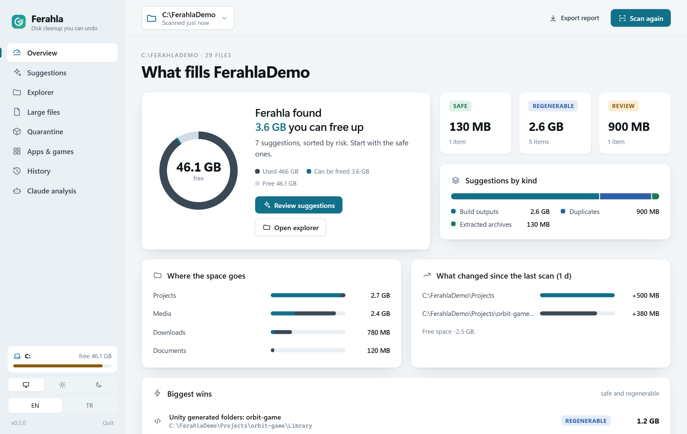
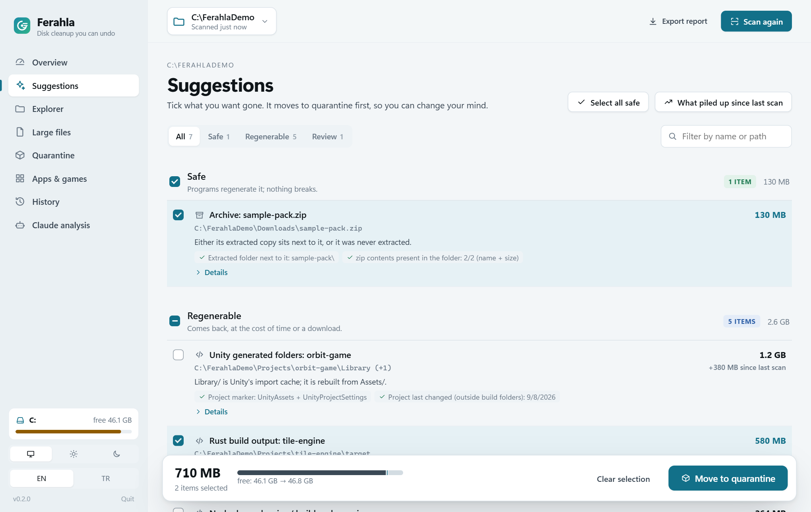
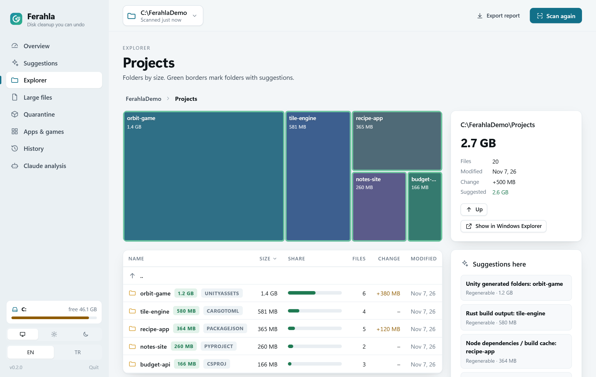

# Ferahla

**Windows diskini neyin doldurduğunu bul, hiçbir şeyi bozmadan temizle.**

[English](README.md)



## İndir

`ferahla.exe`'yi [Releases](https://github.com/BerkayCaglar/ferahla/releases) sayfasından al: tek dosya, kurulum yok,
.NET gerekmez. Windows 10 1809+ ya da 11 (x64). Çift tıkla, tarayıcında açılır. Her sürümde dosyanın SHA-256'sı
yazar; dosyalar sadece bu reponun [sürüm iş akışıyla](.github/workflows/release.yml) derlenir.

Çoğu disk temizleyici büyük klasörleri gösterir, gerisi sana kalır. Ferahla her öneri için şunu söyler:

- **ne olduğunu**: önbellek, derleme çıktısı, zaten kurduğun bir programın kurulum dosyası, zaten açtığın bir arşiv…
- **riskini**: *risksiz*, *yeniden üretilir* (geri gelir ama zaman/indirme ister), *bak, karar ver* ya da *kişisel* (bilgi)
- silinirse **neyin bozulacağını** ve **nasıl geri geleceğini**
- **kanıtını**: "zip içeriği klasörde var: 33/33", "Unity projelerinin hiçbiri bu editörü kullanmıyor",
  "`oyunum` ile aynı remote", "içerik 18 noktada eşleşiyor"

Windows'un kendisini, sayfa dosyasını, çalışan bir sanal makinenin dosyalarını ya da Program Files içindeki herhangi
bir şeyi elle silmek için hiçbir zaman önermez.

## Neler bulur

| | Örnekler |
|---|---|
| Önbellekler | Temp, pip, uv, npm, NuGet, Cargo, Gradle, conda, Unity, GPU shader önbellekleri, tarayıcı önbellekleri |
| Derleme çıktıları | `target/`, `node_modules/`, `bin/obj`, Unity `Library/`, CMake, Gradle, Python `.venv`… proje işaretlerinden |
| Kurulum dosyaları | Downloads/Desktop'ta, zaten kurulu uygulamaların kurulum dosyaları (en yenisi kalır) |
| Arşivler | açılmış `x\` klasörünün yanındaki `x.zip` (girdi girdi doğrulanır), hiç açılmamış eski çok parçalı arşivler |
| Kopyalar | içeriği aynı büyük dosyalar (hardlink'ler hariç); proje klasöründeki kopya kalır |
| Eski sürümler | hiçbir projenin kullanmadığı Unity editörleri, eski CLI sürümleri, eski Playwright tarayıcıları, eski Windows SDK'ları |
| Repo kopyaları | aynı git remote'unun ikinci çalışma kopyaları, ParrelSync klonları |
| Oyunlar | Steam, EA, Riot ve Epic oyunları; kendi launcher'larından kaldırmak için |
| Sistem | hazırda bekletme dosyası (`powercfg -h off`), WinSxS (DISM ile, asla elle), WSL diski, taramanın göremediği alan |

Kurallar [`rules/`](rules) altında JSON olarak, İngilizce ve Türkçe metinlerle duruyor.

## Kullanım

`ferahla` komutunu çalıştır (ya da `ferahla.exe`'ye çift tıkla), tarayıcında açılır: genel bakış, işaretleyeceğin
öneriler, treemap'li klasör gezgini, büyük dosyalar, uygulamalar ve oyunlar, karantina, geçmiş ve isteğe bağlı yapay zekâ analizi (Claude Code ya da Codex). Açık ve koyu tema, Türkçe ve İngilizce.

| Öneriler | Gezgin |
|---|---|
|  |  |

Ekran görüntüleri gerçek bir disk değil, uydurma bir demo klasörü gösteriyor (`tools/demo/make-demo.ps1`).

Pencere, `ferahla.exe`'nin kendisinin sunduğu ve sadece `127.0.0.1` üzerinde çalışan yerel bir sayfadır. Her açılışta
sadece o sekmeye verilen rastgele bir anahtar üretilir; diğer sitelerden gelen istekler reddedilir (host, origin ve
fetch-metadata kontrolleri). Böylece ziyaret ettiğin bir web sayfası Ferahla ile konuşamaz. Son sekme kapandıktan birkaç
dakika sonra kendiliğinden kapanır.

Her şey komut satırında da var:

```
ferahla scan                 sistem sürücüsünü tara (ya da: ferahla scan D:)
ferahla findings             son taramanın sınıflandırılmış önerileri
ferahla findings --risk safe
ferahla diff                 önceki taramadan beri ne büyüdü, ne küçüldü
ferahla inspect <yol>        bir klasörün boyutu, alt klasörleri ve bulguları
ferahla report --open        tek dosyalık, salt okunur HTML rapor (tarayıcıda)
ferahla scans                kayıtlı taramalar
ferahla verify <bulgu>       bir bulguyu şu anki diskte kontrol et: kopyalar bayt bayt, zip ve klasör CRC-32 ile
ferahla note <bulgu> <metin>  bir bulguya kendi notunu ekle

ferahla quarantine --plan <dosya> --dry-run   rapordaki "Plan dosyasını indir" ile alınan planı kontrol et
ferahla quarantine --plan <dosya>             plandakileri karantinaya taşı
ferahla quarantine --list                     karantinada neler var
ferahla restore <kayıt>                       bir karantina kaydını eski yerine koy
```

Her komut `--json` alır (sürümlü şema, anlamlı exit kodları); böylece betikler ve yapay zekâ ajanları da Ferahla'yı
kullanabilir.

### Karantina

Karantina silme değil, taşımadır: öğeler aynı sürücüdeki bir klasöre taşınır (anında olur). Yer, kalıcı olarak
sildiğinde açılır. O zamana kadar `ferahla restore` her şeyi geri koyar.

- Plan sadece bir seçimdir. Ferahla bir şeyi taşımadan önce o taramanın bulgularını yeniden hesaplar ve bir öğeyi
  sadece hâlâ tam olarak o öğeyi öneriyorsa taşır. Elle değiştirilmiş ya da eskimiş bir plan başka bir şey taşıyamaz.
- Plan ne derse desin Windows, Program Files, sürücü kökleri ve profil/sistem klasörlerinin kendileri taşınmaz.
- Temp'te son 24 saatte değişmiş öğeler yerinde kalır.
- Kullanımda olan bir öğe atlanır ve onu tutan programla birlikte raporlanır (Restart Manager ile); gerisi devam eder.
- Karantina, Ferahla'nın verisinin olduğu sürücüde `%LOCALAPPDATA%\Ferahla\quarantine` altında; diğer sürücülerde
  sadece senin, SYSTEM'in ve Administrators'ın açabildiği gizli `X:\.ferahla\quarantine` klasöründe durur. Sadece sabit
  NTFS/ReFS sürücüler; USB ve ağ sürücülerinde sadece bilgi gösterilir.
- Kalıcı silme bilerek bir komut değil: pencerede, onay isteyen bir buton.

Birkaç milyon dosyalı bir sürücünün tam taraması ilk seferde yaklaşık bir dakika, sonrasında bir dakikadan çok daha kısa
sürer. Taramalar `%LOCALAPPDATA%\Ferahla\scans` altında saklanır.

### Yapay zekâ analizi: Claude Code ya da Codex (isteğe bağlı)

[Claude Code](https://claude.com/claude-code) ya da [Codex](https://developers.openai.com/codex) kuruluysa ve oturum
açıksa, **Yapay zekâ analizi** sayfası ondan ikinci görüş ister: taramayı Ferahla'nın kendi salt okunur araçlarıyla
okur (`ferahla.exe` içindeki bir MCP sunucusu) ve önemli her öneriye kısa bir not yazar (kaldır, önce kontrol et,
tut), sonunda da bir özet. Notlar önerilerin yanında ve HTML raporda, yazan yapay zekânın adıyla görünür. Her önerinin
ayrıca hızlı ya da derin bakış ve kendi soruların için bir **Yapay zekâya sor** paneli var. Yapay zekâyı (ve modelini)
Analiz sayfasında ya da panelde seçersin.

- Kendi kurulumunu ve planını kullanır (Claude ya da Codex için ChatGPT). Ferahla kimlik bilgilerini asla okumaz.
- Yapay zekâya başka hiçbir araç verilmez: dosya, kabuk ya da web yok. Hiçbir şeyi taşıyamaz ya da silemez; böyle bir
  araç yok.
- Nötr bir klasörde çalışır; ayarların, kuralların, skill'lerin, eklentilerin, hook'ların ve CLAUDE.md / AGENTS.md
  dosyaların dışarıda bırakılır, ona hiçbir şey onaylanmaz ve Ferahla'nın kendi araçları dışında bir şey görünürse
  çalışma hemen durdurulur.
- Claude: plan kullanımın (5 saatlik ve haftalık) başlamadan önce gösterilir; limitlerine en hafif gelen Haiku'dur.
  Codex plan kullanımını paylaşmaz; her çalıştırma kullandığı token'ı gösterir.
- Ferahla onsuz da tam çalışır.

## Gizlilik

- Telemetri yok. Tek ağ isteği güncelleme kontrolüdür (pencere açıkken GitHub'daki en son sürüm; kapatılabilir). HTML
  rapor internetten hiçbir şey yüklemez. Ayrıntılar: [docs/privacy.md](docs/privacy.md).
- Taramalar ve raporlar bilgisayarında kalır. **Rapor dosya yollarını içerir**: paylaşmadan önce bak.

## Derleme

Windows 10 1809+ ya da 11 (x64), .NET 10 SDK ve NativeAOT bağlama adımı için Visual Studio 2022'nin
*Desktop development with C++* bileşeni gerekir. `vswhere.exe` `PATH`'te olmalı:

```powershell
$env:Path += ";${env:ProgramFiles(x86)}\Microsoft Visual Studio\Installer"
dotnet test --solution Ferahla.slnx
dotnet publish src/Ferahla -c Release -o publish   # publish\ferahla.exe, ~27 MB tek dosya
```

## Yol haritası

1. İmzalı dosyalar ve winget paketi

## Daha fazlası

- [SECURITY.md](SECURITY.md): dosyaların ve yerel pencere nasıl korunuyor; güvenlik açığı bildirme
- [docs/privacy.md](docs/privacy.md): Ferahla neyi saklar, analiz kullanırsan yapay zekâ neyi görür
- [CONTRIBUTING.md](CONTRIBUTING.md) ve [docs/rules.md](docs/rules.md): kural ekleme, derleme, test
- [docs/architecture.md](docs/architecture.md), [docs/spikes.md](docs/spikes.md): nasıl yapıldı ve neden

## Lisans

[MIT](LICENSE). Üçüncü taraf bildirimleri: [THIRD-PARTY-NOTICES.md](THIRD-PARTY-NOTICES.md).
